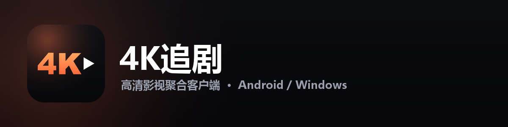
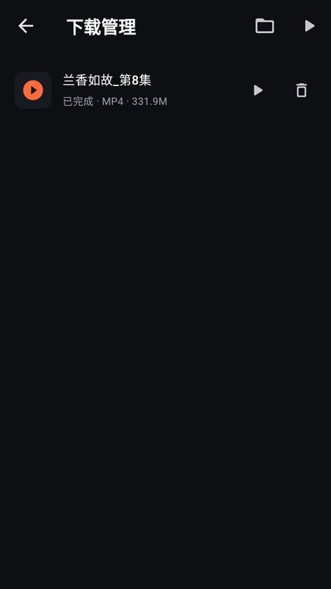
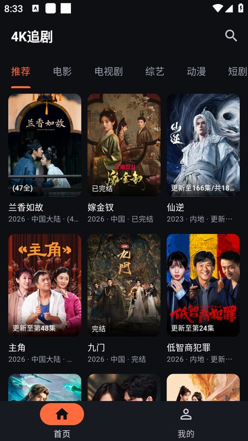
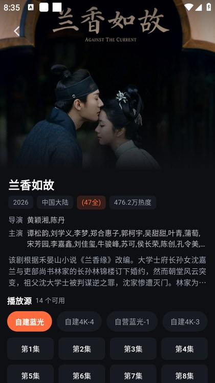
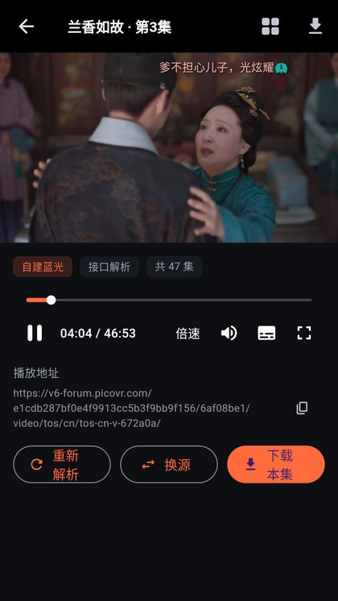
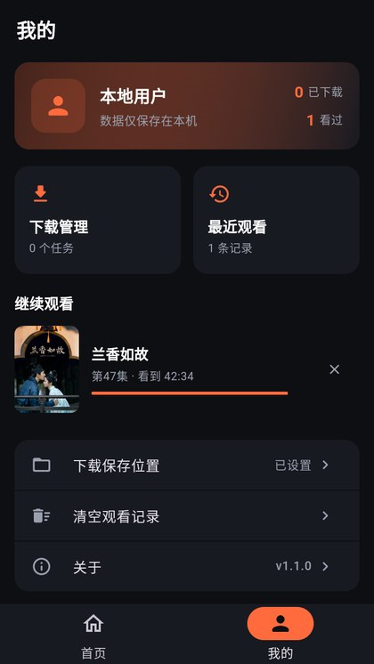

<p align="center">
  
</p>

<p align="center">
  <b>一个干净、能打的追剧播放器</b><br>
  手机装一个就能看，电脑上也能用 —— 没有会员弹窗，没有 90 秒广告。
</p>

<p align="center">
  
  
  
  
  
</p>

---

## 这是什么

说人话：**把你平时在网页上到处找的剧，收进一个 App 里，点开就能看。**

不用注册账号，不用充会员，不用忍受「倒计时 90 秒后可跳过」。下下来就是个纯粹的播放器，打开、挑一部、点播放，就这样。

它和普通视频 App 最大的不同是——**一部剧往往有好几个片源**。某一个源卡了、糊了、挂了，你不用换 App，在播放页面点一下「换源」，自动跳到另一个能用的源，进度接着走。

<br>

## 六个理由

### 一、真·4K，不是标着好看

片源给到多高就放多高，最高支持 4K 分辨率。播放器不会偷偷给你压成 480p 省流量，也不会在片头插一段「高清画质请开通会员」。

大屏电视投屏、电脑全屏看，画面该锐利的地方就是锐利的。

<br>

### 二、点开就播，不用等

很多播放器点一下要转圈十几秒，先解析地址、再握手、再缓冲。这个 App 把这几步提前做了：

- 打开 App 时就已经在后台把首页推荐备好了，不会先给你一片白屏
- 点进详情页，片源已经开始预解析
- 点播放，通常是**一到两秒内出画面**

网络实在差的时候，它会明确告诉你「正在解析，请稍候」，而不是让你盯着一个永远转不完的圈。真解析不出来，才提示换线路——不会骗你说「视频加载中」。

<br>

### 三、能下载，地铁里也能看

看到一半要出门？点「下载本集」，整集存到手机里。



下载管理里能看到进度、速度、剩余时间，支持暂停、继续、删除。**断网了重新连上，会从断的地方接着下**，不用从头再来。

存的是标准 MP4，下完可以直接用系统相册或别的播放器打开，不是那种只能在本 App 里看的加密格式。

<br>

### 四、有弹幕，看剧不孤单

支持实时弹幕，别人发的「哈哈哈哈」「这里我哭了」你也能看到，跟着剧情一起滚过去。


不喜欢？右上角一个开关就关掉，**关掉之后会记住**，下次打开还是关的，不用每次重新设置。

<br>

### 五、没有广告，也没有花里胡哨

这是最不需要解释的一条：

- 没有开屏广告
- 没有片头广告
- 没有暂停时弹出来的游戏推荐
- 没有「邀请好友解锁高清」这类任务

打开就是内容。列表刷起来是顺的，海报是提前加载好的，不会一边滑一边白块。

<br>

### 六、手机和电脑都能装

同一个 App，两个平台：

- **Android**：手机、平板、电视盒子都能装
- **Windows**：电脑上双击即用，鼠标操作，支持全屏

界面按屏幕尺寸自适应，电脑上不是把手机界面硬拉宽，是重新排过版的。

<br>

## 界面长这样

<table>
<tr>
<td align="center" width="25%">
<br>
<b>首页</b><br>
<sub>推荐 / 电影 / 电视剧 / 综艺 / 动漫 / 短剧</sub>
</td>
<td align="center" width="25%">
<br>
<b>详情页</b><br>
<sub>简介、演员、14 个可用播放源</sub>
</td>
<td align="center" width="25%">
<br>
<b>竖屏播放</b><br>
<sub>边看边翻评论，随时切集</sub>
</td>
<td align="center" width="25%">
<br>
<b>我的</b><br>
<sub>下载管理、最近观看、继续观看</sub>
</td>
</tr>
</table>

### 横过来看，才是完整体验

手机横屏或者电脑全屏之后，播放器会切换成影院模式。右上角两个按钮解决大部分问题：

- **选集**：47 集直接列出，点哪集看哪集，不用退回详情页
- **换源**：这个源不行了？一键换到下一个，进度不丢

底部是进度条和常用控件：倍速（0.5x 到 2x）、音量、弹幕开关、全屏。**控制条 3 秒不动会自动隐藏**，不挡画面，点一下屏幕又出来。

<table>
<tr>
<td align="center" width="50%">
<br>
<sub>全屏播放 · 底部控件齐全</sub>
</td>
<td align="center" width="50%">
<br>
<sub>全屏选集 · 不用退出全屏</sub>
</td>
</tr>
</table>

### 一集看完，自动下一集

电视剧不用手动点。当前这集播完，自动接下一集，弹幕也跟着切过去——躺着看剧不用一直摸手机。

<br>

## 功能一览

| 功能 | 说明 |
|:---|:---|
| 分辨率 | 最高 4K，跟随片源，不做额外压缩 |
| 播放源 | 聚合多源，一部剧十几个源，可手动切换 |
| 失败重试 | 源挂了自动跳过，试下一个；全挂才提示 |
| 弹幕 | 实时滚动、可开关、开关状态会记住 |
| 手势 | 双击暂停、左右滑快进、上下滑调音量/亮度、长按 2 倍速 |
| 倍速 | 0.5x / 0.75x / 1.0x / 1.25x / 1.5x / 2.0x |
| 全屏 | 手机横屏、电脑全屏，控件自动隐藏 |
| 选集 | 全屏内直接选，支持自动连播 |
| 下载 | 断点续传、暂停继续、进度可见、存为 MP4 |
| 最近观看 | 自动记录，接着上次看到的地方继续 |
| 收藏 | 追剧列表，封面网格，一键取消 / 清空 |
| 搜索历史 | 保留最近 20 条，可单条删除或清空 |
| 分类 | 推荐 / 电影 / 电视剧 / 综艺 / 动漫 / 短剧 |
| 账号 | **不需要**，打开即用 |
| 广告 | **无** |

<br>

## 片源从哪来

App 里内置 6 个数据源，可以在「我的 → 数据源」里切换和排序。v1.10.0 新增的是两个片子库大、线路直出的源：

| 源 | 片库 | 特点 |
|:---|---:|:---|
| 大师兄 · 暴风 | 171,460 条 | 线路直出 m3u8，稳定性最好 |
| 大师兄 · 量子 | 163,457 条 | 短剧 / 解说 / AI 漫剧资源极多 |

两者互补：同一部剧经常一个站有、一个站没有，或两边线路质量不同，正好用来做「这条线挂了换那条」。

这两个源走的是**标准 JSON 采集接口**（`/api.php/provide/vod/`），不是啃网页 HTML。好处很直接：

- 页面模板改版不会把源搞挂，只要字段名不变就一直能用
- 详情接口一次返回全部播放地址，不用每集再抓一次播放页，点开更快
- 只有域名和 UA 是脆弱点，比正则匹配 class 名稳得多

**片库大不等于每部都能看。** 采集站的内容由对方维护，冷门老剧、刚上线的新剧都可能缺。搜不到就是真没有，这不是本地数据库，变不出来。

> 关于「大师兄影视」那个 App：它自己不托管视频，13 条线路本质是在包装公开采集接口，中间还套了一层会失效的 php 中转。所以这里没有复刻它的中转栈，而是直连原始接口——线路更少，但每条都是真的。

<br>

## 下载安装

<p>
<a href="https://github.com/muyuewang/4K-Zhuiju/releases/download/v1.10.1/4KZhuiju-v1.10.1-release.apk"><b>⬇ Android 版（APK · 56.2 MB）</b></a>
　|　
<a href="https://github.com/muyuewang/4K-Zhuiju/releases/download/v1.10.1/4KZhuiju-v1.10.1-windows-x64.zip"><b>⬇ Windows 版（ZIP · 12.2 MB）</b></a>
</p>

全部版本见 [Releases](https://github.com/muyuewang/4K-Zhuiju/releases)。

### Android

1. 下载 `4KZhuiju-v1.10.1-release.apk`（56.2 MB）
2. 手机上点开安装，如果提示「未知来源」，在设置里允许一次即可
3. 系统要求：Android 7.0 及以上

### Windows

1. 下载 `4KZhuiju-v1.10.1-windows-x64.zip`（12.2 MB，解压后约 30 MB）
2. 解压到任意文件夹（**不要**只把 exe 拖出来，它旁边还有 dll 和 data 目录）
3. 双击 `zhuiju.exe`
4. 系统要求：Windows 10 及以上，64 位

**桌面端操作**

窗口拉宽会自动变成侧边导航 + 更多列海报；播放页按下面这些键就能全程不碰鼠标：

| 按键 | 功能 |
|:---|:---|
| `空格` | 播放 / 暂停 |
| `←` `→` | 快退 / 快进 10 秒 |
| `Shift` + `←` `→` | 快退 / 快进 30 秒 |
| `↑` `↓` | 音量 ±10% |
| `F` | 全屏 |
| `Esc` | 退出全屏 |
| `M` | 静音 |

> 首次打开 Windows 版如果弹出「Windows 已保护你的电脑」，点「更多信息」→「仍要运行」。
> 这是因为安装包没有买代码签名证书，不是有毒。

<br>

## 常见问题

**Q：为什么有的剧搜不到？**
片源来自公开的第三方接口，接口里没有的剧就搜不到。这不是本地数据库，没法凭空变出来。

**Q：播放卡顿 / 一直转圈怎么办？**
先点一下「换源」。一部剧通常有十几个源，A 源慢不代表 B 源也慢。还不行就换个时间段，晚高峰公共源普遍吃力。

**Q：下载的视频在哪？**
「我的」→「下载管理」能看到全部，点进去有保存路径。默认在 App 私有目录，也可以改到相册可见的位置。

**Q：要不要登录 / 收不收费？**
都不要。没有账号体系，因为没有服务器存你的东西——所有记录（看到第几集、下载了什么）都存在你自己手机上。

**Q：换手机了，观看记录还在吗？**
不在。同上，数据是纯本地的，没有云端同步。这是刻意的设计：不收集你的数据，也就没有同步。

<br>

## 自己编译

想改点东西自己用，或者单纯不放心别人给的安装包，可以自己编。

```
环境：Flutter 3.x + Android SDK（打 APK）/ Visual Studio 2022 + C++ 桌面开发（打 EXE）
```

```bash
cd code/flutter_app
flutter pub get
flutter build apk --release        # 出 APK
flutter build windows --release    # 出 EXE
```

产物分别在 `build/app/outputs/flutter-apk/` 和 `build/windows/x64/runner/Release/`。

技术栈和目录说明见 [doc/项目说明.md](doc/项目说明.md)。

<br>

## 说清楚

本项目**不提供、不存储、不转码任何视频内容**。所有影片数据均来自互联网上公开的第三方接口，App 只是一个播放器外壳，本身不含任何片源。

代码仅供技术学习与交流。请勿用于商业用途。因使用本软件产生的任何版权纠纷，由使用者自行承担。

如果你是版权方，认为某个接口侵犯了你的权益，请直接联系接口提供方——本仓库不控制、也无法删除任何第三方服务器上的内容。

<br>

---

<p align="center">
<sub>Made with Flutter · 无广告 · 无账号 · 数据只在你自己设备上</sub>
</p>