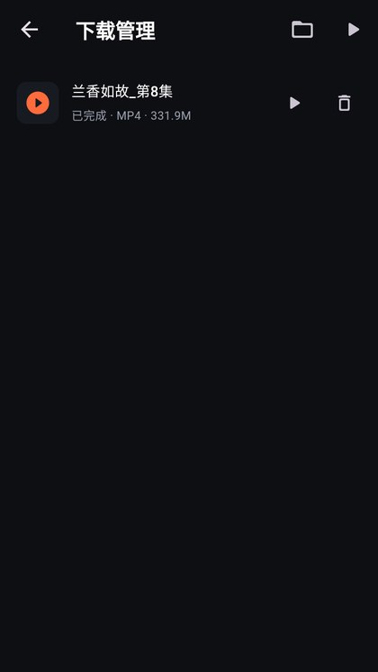
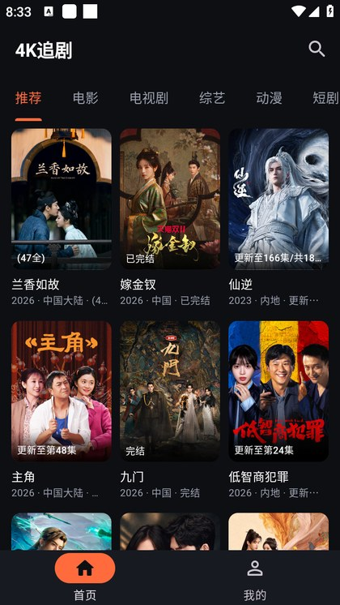
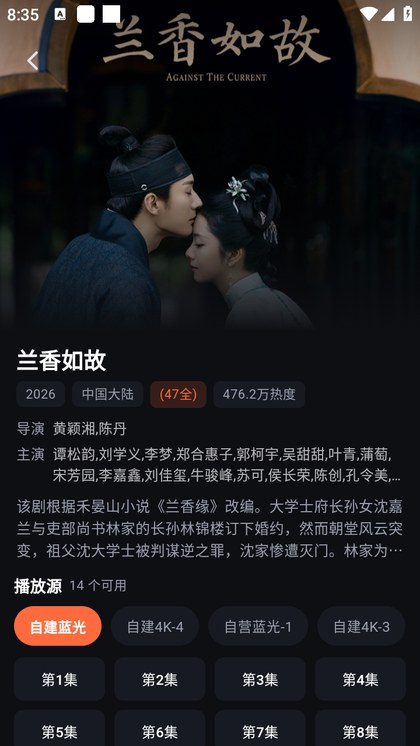
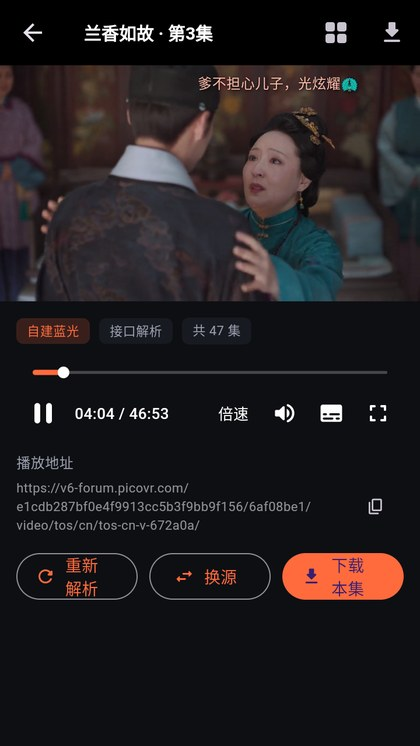
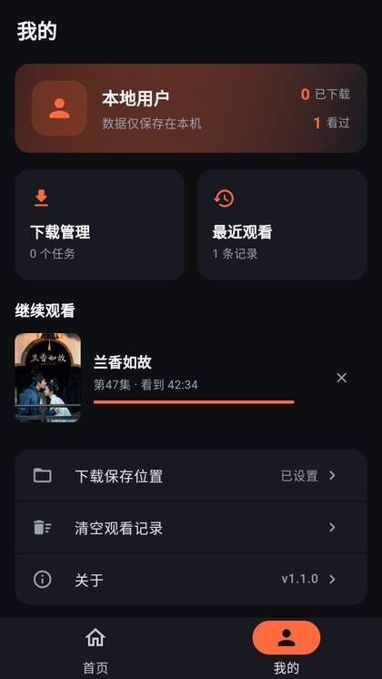

<p align="center">
  
</p>

<p align="center">
  <b>一个干净、能打的追剧播放器</b><br>
  手机装一个就能看，电脑上也能用 —— 没有会员弹窗，没有 90 秒广告。
</p>

<p align="center">
  
  
  
  
  
  
</p>

---

## 这是什么

说人话：**把你平时在网页上到处找的剧，收进一个 App 里，点开就能看。**

不用注册账号，不用充会员，不用忍受「倒计时 90 秒后可跳过」。下下来就是个纯粹的播放器，打开、挑一部、点播放，就这样。

它和普通视频 App 最大的不同是——**一部剧往往有好几个片源**。某一个源卡了、糊了、挂了，你不用换 App，在播放页面点一下「换源」，自动跳到另一个能用的源，进度接着走。

除了点播，它还带一个**直播**页：2676 个频道，央卫视、港澳台、地方台、影视轮播都有，不用再单独装一个电视 App。

<br>

## 七个理由

### 一、真·4K，不是标着好看

片源给到多高就放多高，最高支持 4K 分辨率。播放器不会偷偷给你压成 480p 省流量，也不会在片头插一段「高清画质请开通会员」。

大屏电视投屏、电脑全屏看，画面该锐利的地方就是锐利的。

<br>

### 二、点开就播，不用等

很多播放器点一下要转圈十几秒，先解析地址、再握手、再缓冲。这个 App 把这几步提前做了：

- 打开 App 时就已经在后台把首页推荐备好了，不会先给你一片白屏
- 点进详情页，片源已经开始预解析
- 点播放，通常是**一到两秒内出画面**

网络实在差的时候，它会明确告诉你「正在解析，请稍候」，而不是让你盯着一个永远转不完的圈。真解析不出来，才提示换线路——不会骗你说「视频加载中」。

<br>

### 三、能下载，地铁里也能看

看到一半要出门？点「下载本集」，整集存到手机里。



下载管理里能看到进度、速度、剩余时间，支持暂停、继续、删除。**断网了重新连上，会从断的地方接着下**，不用从头再来。

存的是标准 MP4，下完可以直接用系统相册或别的播放器打开，不是那种只能在本 App 里看的加密格式。

<br>

### 四、有弹幕，看剧不孤单

支持实时弹幕，别人发的「哈哈哈哈」「这里我哭了」你也能看到，跟着剧情一起滚过去。


不喜欢？右上角一个开关就关掉，**关掉之后会记住**，下次打开还是关的，不用每次重新设置。

<br>

### 五、没有广告，也没有花里胡哨

这是最不需要解释的一条：

- 没有开屏广告
- 没有片头广告
- 没有暂停时弹出来的游戏推荐
- 没有「邀请好友解锁高清」这类任务

打开就是内容。列表刷起来是顺的，海报是提前加载好的，不会一边滑一边白块。

<br>

### 六、手机和电脑都能装

同一个 App，两个平台：

- **Android**：手机、平板、电视盒子都能装
- **Windows**：电脑上双击即用，鼠标操作，支持全屏

界面按屏幕尺寸自适应，电脑上不是把手机界面硬拉宽，是重新排过版的。

<br>

### 七、带一个 2676 个频道的直播

底部导航第二个就是「直播」，不是藏在某个角落里。

**2676 个频道**，按七个栏目分组，分页很直白：

| 栏目 | 数量 | 里面是什么 |
|:---|---:|:---|
| 央卫视 | 88 | CCTV 全套 + 各省级卫视 |
| 港澳台 | 37 | 翡翠台、明珠台、广州综合等 |
| 影视 | 130 | 轮播剧集、老片循环 |
| 地方台 | 73 | 各省市地方频道 |
| 一起看 | 801 | 24 小时轮播房 |
| 主播原创 | 1459 | B 站 / 斗鱼主播直播间 |
| 其他 | 88 | 未归类频道 |

顶部可以按栏目切 Tab，也能直接搜频道名。点进去就播，**同一个频道有多条线路的会自动切换**——主线路挂了，播放器自己往下试，并明确告诉你「线路 1 不可用，正在切到线路 2/3」，而不是让你对着黑屏猜。

现在有 12 个频道带备线路（CGTN 系列、东方卫视、浙江卫视、辽宁三台、翡翠台等），共 18 条备线。

这里有个刻意的取舍：**只对官方台做多线路聚合，主播类整类不动**。原因是主播房号「同名不同人」——`YY用户` 底下 69 条是 69 个不同主播，聚成一个频道会让你在几十个陌生人之间乱跳。宁可不切，也不能乱切。

<br>

## 界面长这样

<table>
<tr>
<td align="center" width="25%">
<br>
<b>首页</b><br>
<sub>推荐 / 电影 / 电视剧 / 综艺 / 动漫 / 短剧 / 漫剧</sub>
</td>
<td align="center" width="25%">
<br>
<b>详情页</b><br>
<sub>简介、演员、十几个可用播放源</sub>
</td>
<td align="center" width="25%">
<br>
<b>竖屏播放</b><br>
<sub>边看边翻评论，随时切集</sub>
</td>
<td align="center" width="25%">
<br>
<b>我的</b><br>
<sub>下载管理、最近观看、继续观看</sub>
</td>
</tr>
</table>

### 横过来看，才是完整体验

手机横屏或者电脑全屏之后，播放器会切换成影院模式。右上角两个按钮解决大部分问题：

- **选集**：47 集直接列出，点哪集看哪集，不用退回详情页
- **换源**：这个源不行了？一键换到下一个，进度不丢

底部是进度条和常用控件：倍速（0.5x 到 2x）、音量、弹幕开关、全屏。**控制条 3 秒不动会自动隐藏**，不挡画面，点一下屏幕又出来。

<table>
<tr>
<td align="center" width="50%">
<br>
<sub>全屏播放 · 底部控件齐全</sub>
</td>
<td align="center" width="50%">
<br>
<sub>全屏选集 · 不用退出全屏</sub>
</td>
</tr>
</table>

### 一集看完，自动下一集

电视剧不用手动点。当前这集播完，自动接下一集，弹幕也跟着切过去——躺着看剧不用一直摸手机。

<br>

## 功能一览

| 功能 | 说明 |
|:---|:---|
| 分辨率 | 最高 4K，跟随片源，不做额外压缩 |
| 播放源 | 聚合多源，一部剧十几个源，可手动切换 |
| 失败重试 | 源挂了自动跳过，试下一个；全挂才提示 |
| 弹幕 | 实时滚动、可开关、开关状态会记住 |
| 手势 | 双击暂停、左右滑快进、上下滑调音量/亮度、长按 2 倍速 |
| 倍速 | 0.5x / 0.75x / 1.0x / 1.25x / 1.5x / 2.0x |
| 全屏 | 手机横屏、电脑全屏，控件自动隐藏 |
| 选集 | 全屏内直接选，支持自动连播 |
| 下载 | 断点续传、暂停继续、进度可见、存为 MP4 |
| 最近观看 | 自动记录，接着上次看到的地方继续 |
| 收藏 | 追剧列表，封面网格，一键取消 / 清空 |
| 搜索历史 | 保留最近 20 条，可单条删除或清空 |
| 分类 | 推荐 / 电影 / 电视剧 / 综艺 / 动漫 / 短剧 / 漫剧 / 直播 |
| 直播 | 2676 个频道，7 个栏目分组，支持搜索频道名 |
| 直播多线路 | 同频道多线自动切换，失败即刻切下一条并提示 |
| 账号 | **不需要**，打开即用 |
| 广告 | **无** |

<br>

## 片源从哪来

App 里内置 **19 个数据源**，可以在**首页顶部的源名胶囊**快速切换，也可以在「我的 → 数据源」里切换。

列表按「默认 → 常用 → 采集站（直连）→ 需系统代理」分组，组内按实测首页响应中位数从快到慢排。换源是高频动作（搜不到片、这条线路挂了都要立刻换），所以入口放在了首屏。

| 源 | 类型 | 实测 | 特点 |
|:---|:---|:---|:---|
| 橘汁（默认） | 加密 API | — | 分类齐全、支持弹幕，含直播分类 |
| 看剧（多线路） | 网页解析 | — | 多线路、首页分区榜单，无弹幕 |
| 大师兄 · 暴风 | JSON 采集 | — | 线路直出 m3u8，片库 17 万+ |
| 大师兄 · 量子 | JSON 采集 | — | 短剧 / 解说 / AI 漫剧极多，片库 16 万+ |
| 片库 4K | 网页解析 | — | 分类按电影 / 剧集 / 动漫划分 |
| 电影天堂 | JSON 采集 | 213ms | 响应最快，成片无水印；片库 8.5 万+ |
| 光速资源 | JSON 采集 | 224ms | 短剧极多，另有体育赛事；片库 11.8 万+ |
| 非凡资源 | JSON 采集 | 228ms | 老牌站，条目大多带简介；片库 9.9 万+ |
| 猫眼资源 | JSON 采集 | 264ms | 分类最细，单线路直出最稳；片库 3.4 万+ |
| 索尼资源 | JSON 采集 | 1.4s | 单线路直出；片库 14.9 万+ |
| 起点资源 | JSON 采集 | 1.5s | **片库 23 万+，当前最大**；4 条线路全直出 |
| 金鹰资源 | JSON 采集 | 2.6s | 短剧与国剧更新快；片库 11.8 万+，双线路 |
| 无尽资源 | JSON 采集 | 2.9s | 单线路直出；片库 12.5 万+ |
| 优子资源 | JSON 采集（XML） | 3.3s | 片库 10.9 万+，直出 m3u8 |
| 金山资源 | JSON 采集 | 4.4s | 片库 11.6 万+，直出 m3u8；响应最慢 |
| 4K影视 | 网页解析 | — | 需系统代理；4K 线路需站点 VIP，自动降级 1080P |
| 极速追剧 | 网页解析 | — | 需系统代理；线路较多，各线路集数可能不同 |
| 云影 | 网页解析 | — | 需系统代理；分类齐全，各线路集数可能不同 |
| 低调影视 | 网页解析 | — | 需系统代理；在线播放直出，另有网盘资源 |

前九个的耗时是首页 `ac=list` 首屏中位数（10 次采样取中位，国内网络直连、不带代理）。

后面六个（索尼到金山）的口径不同，单独说明：这批站要**多走一次 `ac=detail` 才能换到封面**——它们的 `ac=list` 把 `vod_pic` 砍了，只有详情接口才给图。所以数字里含了那次额外请求，不能和前面直接比。这也是它们看起来「慢一截」的主要原因，不是接口本身慢。

> 为什么不统一都用 `ac=list` 保持口径一致：那六个站用 `ac=list` 首页会是一片灰底占位图。实测过「列表出 20 条 → 并发拉 20 次 detail 拿封面」，反而更贵（单条 detail 几十上百 KB，20 条并发约 500 KB + 20 个连接）。也试过 `fields=vod_id,vod_pic` 裁字段，**服务端不认**，照样返回全部字段。所以这是用流量换封面的明账权衡。

**v1.11.5 移除了两个源**，老用户会注意到少了：

| 已移除 | 原因 |
|:---|:---|
| 可可影视 | 站是活的，但 App 拿不到数据。详情页两个容器是空的、`playSource.src` 是硬编码空串，选集与地址改由 JS 签名异步取，而那个 API 直连超时、走代理 502。浏览器能播是因为它跑得动 JS，App 拿到的静态 HTML 里就是空的 |
| 樱花资源 | 站方采集太慢，大部分片子不能看。同一部剧别的源 25 集、它只有 23 集 |

多源的意义在于互补：同一部剧经常一个站有、一个站没有，或两边线路质量不同，正好用来做「这条线挂了换那条」。

采集类源走的是**标准 JSON 采集接口**（`/api.php/provide/vod/`），不是啃网页 HTML。好处很直接：

- 页面模板改版不会把源搞挂，只要字段名不变就一直能用
- 详情接口一次返回全部播放地址，不用每集再抓一次播放页，点开更快
- 只有域名和 UA 是脆弱点，比正则匹配 class 名稳得多

接入这批采集站时踩到四个共同的坑，都在适配器里统一处理了：

1. **父分类恒为空。** `t=1`（电影）/`t=2`（电视剧）这类父分类在 `ac=list` 下一条都不返回，数据全挂在子分类上（`6` 动作片、`13` 国产剧…）。所以每个源的分类都是逐个实测出来的子分类组合，不是猜的。
2. **逗号参数不聚合。** `t=6,7` 和 `t=6` 返回的 `total` 完全一样，逗号后面全被忽略。分类合并只能在客户端做——并发拉多个子分类再交错合并，否则第一屏会全是同一个子分类。
3. **第一条线路往往是网页分享页。** 主流采集站给同一部剧下发两条线路，第一条是 `…/share/<md5>` 的 HTML 页，第二条才是直出 m3u8。播放器默认取第一条，而分享页里的 m3u8 靠 JS 渲染、抠不出来，表现就是「点进去播不出来」。现在详情解析时会检验首条线路形态，把直出线路提前。
4. **有的站 GET 搜索被拦。** 某个站的 `?ac=list&wd=关键词` 会被 nginx 返回 403（连 PHP 都没进），换 UA / Referer / 手机 UA 都没用，改用 POST 表单提交就正常。所以适配器上留了个 `searchViaPost` 开关。那个站本身已因采集太慢被移除，但开关保留着——以后接入的站若同样把 GET 的 `wd` 在 nginx 层拦掉，打开即可，不必改请求代码。

说明两件事：

- **需要系统代理的源**（4K影视 / 极速追剧 / 云影 / 低调影视）在原站国内直连不通，App 会自动读取 Windows 系统代理设置；Android 端走系统网络，一般无需额外设置。这四个固定排在列表最后，切换面板里会打上「需代理」标记并单独说明。
- **片库大不等于每部都能看。** 采集站的内容由对方维护，冷门老剧、刚上线的新剧都可能缺。搜不到就是真没有，这不是本地数据库，变不出来。

再补一句播放链路的现状：桌面端的视频流**不经过任何本地中转**，播放器直接连源站，和安卓的 ExoPlayer、浏览器完全一样。系统代理是通过进程环境变量交给 FFmpeg 的（libmpv 不读 Windows 系统代理，但它读 `http_proxy`），所以取流仍是播放器自己的并行预读，不存在「多绕一层」的吞吐损失。v1.11.4 之前的版本有一层 m3u8 中转，取流被压成单线程串行，这才是在 PC 上一直转圈的原因。

> 关于「大师兄影视」那个 App：它自己不托管视频，13 条线路本质是在包装公开采集接口，中间还套了一层会失效的 php 中转。所以这里没有复刻它的中转栈，而是直连原始接口——线路更少，但每条都是真的。

### 数据源可以在线更新（v1.11.7 起）

原来那 19 个源是编译在安装包里的，改一个域名就得发一次版。2026-11-17 橘汁主域名整站 502、官方已经在换服务器，而用户手里是旧包、旧包里是旧域名，只能吃一整片「连接失败」——这类问题不该再等下一次发版。橘汁现已按用户要求移除，当前 18 个源全部走插件配置。

现在数据源的配置改成从仓库远程加载：

- 索引与解析脚本放在 [`config/plugins/`](config/plugins/)，改完推到 main 分支，App 下次启动自动生效，**不需要发版**
- 解析逻辑跑在 QuickJS 里，脚本能自己发请求、解析 JSON / XML、做签名（HMAC / AES / RSA 都可用）
- 切换源不需要发版：远程配置拉不到、拉成空、甚至整个目录被误删，本机已有的源一个都不会少
- 「我的 → 刷新插件配置」可以手动刷新，改完配置想立刻确认时不用反复杀进程

配置格式、可用能力和写脚本的注意事项都在 [`config/plugins/README.md`](config/plugins/README.md)。国内访问 GitHub raw 是不通的，所以走镜像（`ghproxy.net` / `gh-proxy.com`），**索引和脚本必须放在同一个镜像下**，否则会出现「索引拉到了、脚本拉不到」。

<br>

## 下载安装

<p>
<a href="https://github.com/muyuewang/4K-Zhuiju/releases/download/v1.11.6/4KZhuiju-v1.11.6-release.apk"><b>⬇ Android 版（APK · 57.2 MB）</b></a>
　|　
<a href="https://github.com/muyuewang/4K-Zhuiju/releases/download/v1.11.6/4KZhuiju-v1.11.6-windows-x64.zip"><b>⬇ Windows 版（ZIP · 65.4 MB）</b></a>
</p>

全部版本见 [Releases](https://github.com/muyuewang/4K-Zhuiju/releases)。

### Android

1. 下载 `4KZhuiju-v1.11.6-release.apk`（57.2 MB）
2. 手机上点开安装，如果提示「未知来源」，在设置里允许一次即可
3. 系统要求：Android 7.0 及以上

### Windows

1. 下载 `4KZhuiju-v1.11.6-windows-x64.zip`（65.4 MB，解压后约 167 MB）
2. 解压到任意文件夹（**不要**只把 exe 拖出来，它旁边还有 dll 和 data 目录）
3. 双击 `zhuiju.exe`
4. 系统要求：Windows 10 及以上，64 位

> **Windows 包从 32 MB 涨到了 65 MB**，别以为是下错了。v1.11.5 把播放内核从 FFmpeg n6.0 换成了 N-128766（mpv v0.42），`libmpv-2.dll` 从 28 MB 变成 116 MB。换来的是更新的解码器和对 4K / HEVC 更好的支持。

**桌面端操作**

窗口拉宽会自动变成侧边导航 + 更多列海报；播放页按下面这些键就能全程不碰鼠标：

| 按键 | 功能 |
|:---|:---|
| `空格` | 播放 / 暂停 |
| `←` `→` | 快退 / 快进 10 秒 |
| `Shift` + `←` `→` | 快退 / 快进 30 秒 |
| `↑` `↓` | 音量 ±10% |
| `F` | 全屏 |
| `Esc` | 退出全屏 |
| `M` | 静音 |

> 首次打开 Windows 版如果弹出「Windows 已保护你的电脑」，点「更多信息」→「仍要运行」。
> 这是因为安装包没有买代码签名证书，不是有毒。

<br>

## 常见问题

**Q：为什么有的剧搜不到？**
片源来自公开的第三方接口，接口里没有的剧就搜不到。这不是本地数据库，没法凭空变出来。

**Q：播放卡顿 / 一直转圈怎么办？**
先点一下「换源」。一部剧通常有十几个源，A 源慢不代表 B 源也慢。还不行就换个时间段，晚高峰公共源普遍吃力。

**Q：以前出现过「下拉刷新一直超时，怎么刷都不行，杀掉 App 重开就秒出」，现在还有吗？**
已经修了，v1.10.7 起不会再出现。

原因是请求超时的写法有缺陷：`.timeout()` 只让界面不再等，**并不会真的取消底层请求**，那条连接仍然挂在系统里。反复刷新失败一次就漏一条，攒够之后本地端口和 NAT 会话表被占满，新的连接根本发不出去——表现就是「连接超时，请检查网络」，而且越刷越糟。杀掉 App 会把所有连接一次性还给系统，所以重开就好。

同一类缺陷还修了「快速连点换源」：多个解析流程并存时，先完成的那个播放器会失去引用、永远不释放，解码器和连接一起泄漏。

现在每个请求在超时后都会主动 abort，换源也有代次保护，作废的流程会自己收拾干净。补了两个回归测试盯着这件事，其中一个是静态扫描，以后加新数据源时写法倒退会直接测试失败。

**Q：下载的视频在哪？**
「我的」→「下载管理」能看到全部，点进去有保存路径。默认在 App 私有目录，也可以改到相册可见的位置。

**Q：直播页的频道点了播不出来？**
两种情况，都会明确告诉你原因：

1. **提示「N 条线路都试过了」**——这个频道的所有线路都暂时不通。直播源来自公开聚合，单个台挂掉是常态，换个台或过一会儿再试。
2. **提示「TOKEN已到期」**——部分频道走的是带时效 token 的地址，源站那边过期了。等源站刷新即可，客户端无法绕过。

另外直播和点播不同：**直播不记录观看进度**，也不会自动跳下一个台。这两条是刻意的——对一个一天到晚不停的流记录「看到第几分钟」没有意义，而自动跳台会让你睡着后醒来发现播到别的频道去了。

**Q：为什么直播有的台有多条线路，有的只有一条？**
多线路来自公开源里同一个台的不同地址，聚合后自动合并。目前 12 个频道有备线（CGTN 系列、东方卫视、浙江卫视、辽宁三台、翡翠台等），共 18 条备线。

**主播类不做多线路是故意的**：主播房号存在「同名不同人」的情况，比如 `YY用户` 底下 69 条其实是 69 个不同主播。聚成一个频道会让你点进去在几十个陌生人之间乱跳，比不能切换糟糕得多。官方台台名唯一，才敢聚合。

**Q：直播卡 / 模糊能换清晰度吗？**
不能。直播的清晰度由源站决定，客户端只能原样播。同一个台如果有多条线路，线路之间画质可能不同，可以用「换线路」碰运气。

**Q：要不要登录 / 收不收费？**
都不要。没有账号体系，因为没有服务器存你的东西——所有记录（看到第几集、下载了什么）都存在你自己手机上。

**Q：换手机了，观看记录还在吗？**
不在。同上，数据是纯本地的，没有云端同步。这是刻意的设计：不收集你的数据，也就没有同步。

<br>

## 自己编译

想改点东西自己用，或者单纯不放心别人给的安装包，可以自己编。

```
环境：Flutter 3.x + Android SDK（打 APK）/ Visual Studio 2022 + C++ 桌面开发（打 EXE）
```

```bash
cd code/flutter_app
flutter pub get
flutter build apk --release        # 出 APK
flutter build windows --release    # 出 EXE
```

产物分别在 `build/app/outputs/flutter-apk/` 和 `build/windows/x64/runner/Release/`。

### 如果 `flutter build windows` 报找不到 VS 工具链

```
Unable to find suitable Visual Studio toolchain. Please run `flutter doctor` for more details.
```

**这个提示会骗人。** 它不代表你真的没装编译器。实测下来有三种完全不同的成因，其中只有第一种是「真的缺东西」：

**成因一：确实缺组件。** `flutter doctor` 会明确指出缺哪个工作负载，按提示装 **「使用 C++ 的桌面开发」** 即可。

**成因二：编译器装着，但缺工作负载标记。** Flutter 判断能否编译，靠的是执行：

```bash
vswhere -products '*' -requires Microsoft.VisualStudio.Workload.NativeDesktop -property installationPath
```

只查这个标记，**不查编译器本身在不在**。如果你的 VS 是自定义安装、勾了 MSVC 但没勾「桌面开发」这个整体工作负载，`vswhere` 就返回空，Flutter 直接判定「没有可用工具链」——而 `VC.Tools.x86.x64` 其实是命中的，编译能力完好。

确认方式：

```bash
VSW="/c/Program Files (x86)/Microsoft Visual Studio/Installer/vswhere.exe"
"$VSW" -products '*' -requires Microsoft.VisualStudio.Component.VC.Tools.x86.x64 -property installationPath   # 有输出 = 编译器在
"$VSW" -products '*' -requires Microsoft.VisualStudio.Workload.NativeDesktop -property installationPath        # 空 = 就是这个原因
```

两条路：打开 VS Installer 补勾「使用 C++ 的桌面开发」（一劳永逸），或者走下面的手动编译。

**成因三：`reg.exe` 被安全策略拦。** Flutter 还会用 `reg query` 查注册表读 Windows 版本。如果 `reg.exe` 在程序黑名单里，`flutter doctor` 会直接打出 `Flutter failed to run "reg query ..."`。这种情况把 `reg.exe` 移出黑名单即可。

#### 手动用 CMake 编译

绕过 Flutter 的探测，直接驱动 CMake。**三步都要做**，少一步就会打出旧代码或残缺的包：

```bash
cd code/flutter_app

# ① 清掉大小写两套代理变量（必须）
for v in http_proxy https_proxy HTTP_PROXY HTTPS_PROXY ALL_PROXY all_proxy NO_PROXY no_proxy; do unset $v; done

# ② 编译 C++ 外层
cmake --build build/windows/x64 --config Release

# ③ 让 Dart AOT 与资产真正打包（关键，见下方说明）
cmake --install build/windows/x64 --config Release \
  --prefix "$PWD/build/windows/x64/runner/Release"
```

三个坑，每个都踩过：

**坑 1：不清代理变量，编译直接崩。**

```
error MSB6001: "CL.exe"的命令行开关无效。
System.ArgumentException: 已添加项。字典中的关键字:"HTTPS_PROXY"所添加的关键字:"https_proxy"
```

报错指向 `CL.exe` 的命令行，看着像编译选项写错了，实际跟编译毫无关系——MSBuild 构造子进程环境用的 Hashtable **不区分大小写**，环境里同时存在 `HTTPS_PROXY` 和 `https_proxy` 时插入直接抛异常。

**坑 2：不能只 build，必须 install。** `cmake --build` 只产出 C++ 的 exe，`--prefix` 那步才把 AOT 快照和资产铺到 `Release/`。只做 ② 的结果是「exe 是新的、代码是旧的」。

注意不能用 `cmake --build ... --target INSTALL`。缓存里 `CMAKE_INSTALL_PREFIX` 存的是生成器表达式 `$<TARGET_FILE_DIR:zhuiju>`，经 build target 走不会展开，`file COPY` 会报 `Invalid argument`。必须用 `cmake --install --prefix <绝对路径>`。

**坑 3：`flutter_assemble` 会被判定「已是最新」而跳过。** CMake 里那几个自定义 target 的产物（`flutter_windows.dll` 等）一旦存在，MSBuild 就认为无需重建，**Dart 编译和资产打包一并不跑**。

判断产物新旧，**不能看 `zhuiju.exe` 的时间戳**（那只是链接时刻），要看这两个：

```bash
ls -l build/windows/app.so                                        # Dart AOT 快照
ls -l build/windows/x64/runner/Release/data/flutter_assets/       # 资产
```

如果 exe 是新的但这两个是旧的，说明被跳过了。这时手动触发一次：

```bash
cmake -E env "FLUTTER_ROOT=C:\\flutter_sdk" \
  "PROJECT_DIR=C:\\path\\to\\code\\flutter_app" \
  "FLUTTER_TARGET=lib\\main.dart" \
  cmd //c "C:\\flutter_sdk\\packages\\flutter_tools\\bin\\tool_backend.bat windows-x64 Release"
```

> 想让 MSBuild 别偷懒，也可以在 build 前先删掉 `build/windows/x64/flutter/ephemeral/flutter_windows.dll`，逼它重跑 assemble。

**验证 AOT 里确实是新代码**：Dart 字符串在 `app.so` 里是 **UTF-16LE**，用 `grep` 按 UTF-8 搜会全部返回 0，很容易误判成「产物没更新」。正确做法：

```bash
python -c "d=open('build/windows/x64/runner/Release/data/app.so','rb').read(); print(d.count('随便找个新版本才有的文案'.encode('utf-16-le')))"
```

技术栈和目录说明见 [doc/项目说明.md](doc/项目说明.md)。

<br>

## 说清楚

本项目**不提供、不存储、不转码任何视频内容**。所有影片数据均来自互联网上公开的第三方接口，App 只是一个播放器外壳，本身不含任何片源。

代码仅供技术学习与交流。请勿用于商业用途。因使用本软件产生的任何版权纠纷，由使用者自行承担。

如果你是版权方，认为某个接口侵犯了你的权益，请直接联系接口提供方——本仓库不控制、也无法删除任何第三方服务器上的内容。

<br>

---

<p align="center">
<sub>Made with Flutter · 无广告 · 无账号 · 数据只在你自己设备上</sub>
</p>